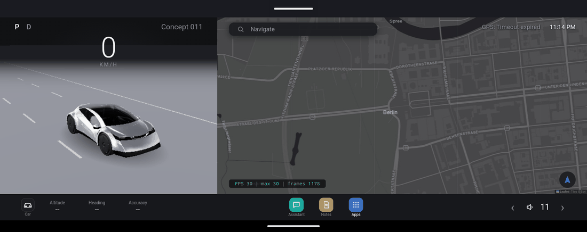
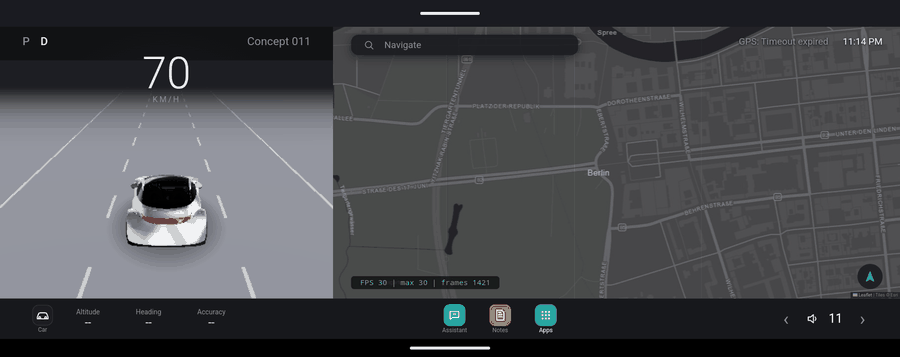
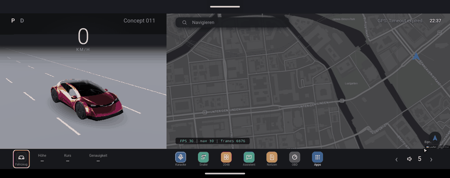
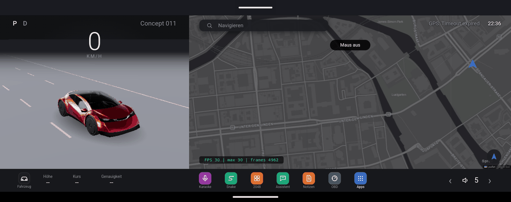

# DriveDeck

[English](README.md) · [Deutsch](README.de.md) · [Türkçe](README.tr.md) · **中文**

为 Carlinkit CPC200 T-Box（Android 13，骁龙 665，1816×720 屏幕）打造的特斯拉风格座舱界面。
应用是一个 Android WebView，整个界面由 HTML/JS 编写：3D 车辆使用 three.js，地图使用 Leaflet。



## 功能

- **3D 车辆**与行驶视角：车轮随 GPS 速度转动，路面向后流动，停车时点击可打开剪刀门。
  多种车型和车漆颜色。画面中没有任何运动时场景保持静止，只在有变化时才重绘，所以停车时不占用 GPU。
- **节能模式**（默认）：限制 30 FPS，关闭抗锯齿，使用更小的渲染缓冲区。可在设置中关闭。
- **导航**基于开放数据：搜索（Photon / OpenStreetMap）、路线（OSRM）、语音转向提示、自动重新规划、
  收藏地点、附近和沿途搜索、限速标志、天气。
- **Dock 栏**仿特斯拉：带文字说明的大图标，Apps 按钮紧挨着快捷方式。长按应用可加入或移出 Dock。
- **助手**：通过 OpenRouter 调用的大模型，操作内置浏览器：搜索、阅读、点击、输入、启动导航、
  记笔记和计时器、播放音乐和视频。三种布局：窗口、半屏、全屏（影院）。支持德语、土耳其语和英语的语音输入与播报。
  密码由应用自己填入网页，模型永远看不到。
- **手机配对**：盒子显示二维码，手机打开由盒子提供的页面，并发送 API 密钥、登录信息、目的地和链接。
  全程端到端加密（AES-GCM），并用 Android Keystore 密钥保存。
- **虚拟鼠标**，用车上的方向键控制（见下文）。
- 笔记、OBD 仪表（通过蓝牙连接 ELM327）、2048、贪吃蛇、卡拉 OK、画图。
- 首次启动时显示**介绍导览**（德语、土耳其语、英语），也可用方向键和中间键操作。可在 Apps → Einstellungen → Einführung 中重新打开。
- 行车锁定：时速超过 5 公里时，浏览器、游戏和文字输入被锁定，只保留语音。



## 虚拟鼠标

在 **Apps → Einstellungen → Maus** 中开启，或者按住车上方向键的中间键约一秒。
这些按键会作为普通的方向键和 Enter 键传给页面。

| 按键 | 操作 |
|---|---|
| 方向键 | 移动指针。按一下移动一小步，按住会加速 |
| 中间键，短按 | 点击 |
| 中间键，按住 | 按住鼠标键（拖动，可平移地图） |
| 中间键，快速按两下 | 切换到滚动模式：上下键滚动指针下方的列表 |

文字输入框获得焦点时，按键保持正常功能。点击和滚动在助手的浏览器中同样有效。





## 下载与安装

已签名的 APK 发布在 **Releases** 中。推送 `v1.2` 这样的标签（`git tag v1.2 && git push origin v1.2`）就会创建新版本，
由 GitHub Actions 构建 APK。所有版本都使用同一个密钥（`app/release.keystore`）签名，所以新 APK 可以直接覆盖安装，
不会丢失数据。在盒子上：用浏览器下载 APK，点击它，并允许“安装未知应用”。不需要 USB 调试。

## 构建

要求：JDK 17+，Android SDK（platform 34）。

```bash
echo "sdk.dir=$HOME/Android/Sdk" > local.properties
./gradlew assembleDebug        # 签名 APK 请用 assembleRelease
adb install -r app/build/outputs/apk/debug/app-debug.apk
```

盒子上的界面可以用 `chrome://inspect` 调试。

## 模拟器与行驶模拟

```bash
tools/emulator.sh          # 接近真实的模式，构建、安装并启动应用
node tools/drive.mjs       # 把真实的 OSRM 路线作为 GPS 送入模拟器
tools/emulator-pairing.sh  # 让局域网中的手机能访问配对页面
```

AVD `tbox` 模拟盒子的屏幕、内存和 Android 版本。GPU 无法完全复制：在模拟器中能跑到 30 FPS 的内容，在盒子上会很流畅。

## 结构

```
app/src/main/java/.../MainActivity.java   WebView、资源服务器、桥接 window.TBox（音量、TTS、浏览器、大模型、语音）
app/src/main/java/.../PairingServer.java  配对服务器，与手机的加密交换
app/src/main/java/.../SecretStore.java    用 Android Keystore 密钥加密的机密信息
app/src/main/assets/web/
  app.js, car3d.js, nav.js, apps.js       核心、3D 场景、导航、应用启动器和 Dock
  mouse.js                                虚拟鼠标
  browser.js, apps/assistant.js           助手及其浏览器
  weather.js, speedlimit.js, reminders.js, media.js, inbox.js
```

## 盒子的性能规则

- HDRI 反射开销最大：只有反光材质才使用。
- Clearcoat 和 specular 会生成 `MeshPhysicalMaterial`，加载时会转换为标准 PBR。
- 模型保持在约 11 万个三角面以内，对象（draw call）尽量少。

## 状态

已在模拟器中测试：界面、导航、配对、笔记、计时器、布局、虚拟鼠标。尚未在真机上测试：语音识别（需要 Google 语音服务）、
OBD、限速标志和附近搜索（取决于公共 Overpass 服务器）。

## 许可与来源

- Free Concept Car 011（Sketchfab，CC0）、Kenney 的 Car Kit（CC0）、Poly Haven 的影棚 HDRI（CC0）
- three.js（MIT）、Leaflet（BSD-2）、meshoptimizer（MIT）
- 地图瓦片：Esri World Dark Gray。搜索：Photon / OpenStreetMap。路线：OSRM 演示服务器，仅限个人使用。
